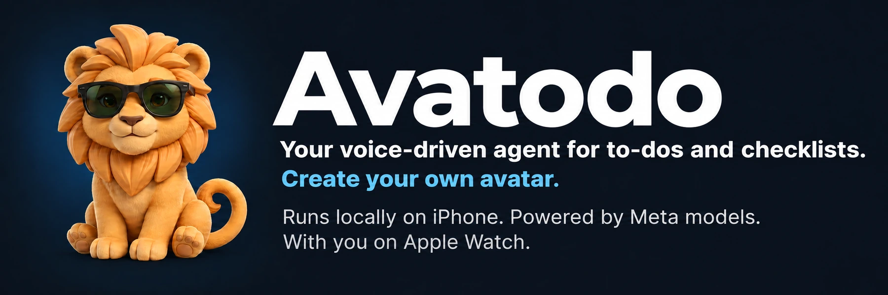

# Avatodo 🦁

<p align="center">
  <picture>
    <source media="(prefers-color-scheme: light)" srcset="https://github.com/danci5/avatodo-hackathon/raw/refs/heads/main/docs/images/avatodo-banner-light.webp">
    
  </picture>
</p>

<p align="center">
  <strong>iOS 26+ &nbsp; · &nbsp; watchOS 26+ &nbsp; · &nbsp; Meta Muse &nbsp; · &nbsp; Apache-2.0</strong>
</p>

<p align="center">
  <a href="#what-avatodo-does">Features</a> &nbsp; · &nbsp;
  <a href="#how-it-works">How it works</a> &nbsp; · &nbsp;
  <a href="#get-started">Get started</a> &nbsp; · &nbsp;
  <a href="#development">Development</a> &nbsp; · &nbsp;
  <a href="#privacy">Privacy</a>
</p>

---

Avatodo is a voice-driven, locally running agent that takes care of your to-do lists, notes and checklists on **iPhone and Apple Watch**. Talk to your companion to capture a task, change a plan or check something off. Start with the lion, or create a character of your own.

The **agent and note storage run on your iPhone**. Reasoning and image generation use **Meta's remote models**, called directly with your own API key. No Avatodo-hosted backend, shared developer key or mandatory Avatodo account.

## What Avatodo does

- **🎙️ Turn words into to-dos.** Talk or type to create notes, tasks and checklists.
- **✅ Keep the list moving.** Correct an item, mark it complete or undo a saved change. You can also edit notes and check off items manually.
- **⌚ Pick it up on your wrist.** Use the paired Apple Watch to talk to the same companion and reach the agent on your iPhone.
- **🦁 Make it yours.** Keep the included lion, or describe a companion for Meta Muse Image to create. The same character appears on both devices.
- **📱 Keep your notes local.** Notes and edit/Undo receipts are saved on iPhone. Conversation stays in memory, with a five-minute idle timeout and a **Start fresh** action.
- **☁️ Optional Drive copies.** Connect your own Google account to upload Markdown copies into an Avatodo folder. Local edits update the copies; Drive edits are not imported. See [setup and limits](docs/google-drive.md).

### A little less tapping

Example requests for a grocery checklist:

| You say | Avatodo does |
| --- | --- |
| “Make a grocery checklist with milk, eggs and bread.” | Creates a note with checkable items. |
| “Change milk to oat milk.” | Updates the item in the checklist. |
| “I've got the eggs and bread.” | Marks those items complete. |

Open a note and choose **Update this note** to keep the conversation focused on that exact list. Ordinary conversation does not create a note.

## 🦁 Meet your companion


The lion is ready from the first launch. For a different companion, describe what you have in mind: **Muse Image creates the artwork**, and Avatodo prepares it locally and sends the same character to your Watch.

Local animation responds to listening, thinking, speaking and saved changes. New companions get artwork and a reference-based animation sheet, prepared into a cached frame sequence. Tap the companion to dance; preview or regenerate a custom companion's animations in Your companion. Playback needs no new model request. Generated pose quality can vary, and failed preparation keeps the base artwork usable.

## How it works

**Speak → Meta interprets your request → the iPhone agent saves the change → your companion replies.**

| On your devices | Through Meta |
| --- | --- |
| Agent orchestration, validated note actions and local storage on iPhone | Language reasoning and tool selection with `muse-spark-1.3` (default) or `muse-wonder-1.0` |
| Paired Watch interface, local artwork preparation and animation | Custom companion artwork with `muse-image-1.0` |
| Your API key in iPhone Keychain; never sent to Watch | Direct requests using your own provider access |

Watch audio is relayed to the paired iPhone for Apple speech recognition. The Watch relies on that phone; it is not a standalone agent. **Local execution does not mean offline model inference:** Meta features require internet access and send relevant text, note context and character descriptions to Meta.

See the [architecture](docs/architecture.md) and [local task engine](docs/local-task-engine.md) for the implementation.

## Get started

You'll need a **Mac with Xcode 27**, the iOS/watchOS SDKs, and your own Meta access to `muse-spark-1.3` (or optional `muse-wonder-1.0`) and `muse-image-1.0`. Deployment targets are **iOS 26** and **watchOS 26**. Running on hardware also requires compatible paired devices and Apple signing.

```sh
git clone https://github.com/danci5/avatodo-hackathon.git
cd avatodo-hackathon
open Avatodo.xcodeproj
```

1. Select the **Avatodo** scheme and an iPhone destination. For hardware, choose your signing team for both app targets.
2. Run the iPhone app and its paired Watch companion. Cloning the repository does not install the Watch app automatically.
3. On iPhone, open **Settings**, enter your own Meta API key and save it in Keychain.
4. Review **Data sharing with Meta** and allow Meta requests, then talk or type to your companion.

The Xcode project and required artwork are included. **No backend setup is required.** XcodeGen is only needed to regenerate the project after changing `project.yml`.

See [native app setup](docs/native-app.md) for simulator, speech, signing and invited TestFlight installation details.

## Development

**Current stage: an early native app in internal testing.** The iPhone and Watch targets build and run in paired simulators. Real Meta calls have created notes, updated and completed checklist items, and generated a matching custom companion on both simulators. Internal TestFlight builds have been processed; complete physical-device acceptance is still in progress. There is no public beta link or App Store release.

The [release evidence](docs/release-evidence.md) records build-specific results and distinguishes simulator, live-model and physical-device checks.

<details>
<summary><strong>Run the local development checks</strong></summary>

```sh
bash scripts/test.sh
zsh scripts/check-audio-relay.sh
zsh scripts/check-character-transfer.sh
zsh scripts/check-character-animation.sh
zsh scripts/check-companion-motion.sh
zsh scripts/check-reply-audio.sh
zsh scripts/check-meta-consent.sh
```

These checks need no API key. The explicit live check, `swift run AvatodoProbe --run-live`, sends billable requests with fictional notes. Read [secure Meta development setup](docs/meta-development-setup.md) first.

</details>

Explore the [shared Swift live Meta evidence](docs/shared-swift-live-evidence.md), or read [Contributing](CONTRIBUTING.md) to work on the app.

## Privacy

- **Your key stays on iPhone.** It is stored in Keychain and never transferred to Watch.
- **Meta requests need your permission.** Meta features require users aged **18 or older**, legitimate provider access and explicit consent in **Settings → Data sharing with Meta**. API usage charges may apply.
- **Model requests send relevant content to Meta.** This includes text, note context and companion descriptions. Local storage and conversation expiry do not imply zero provider retention.
- **Speech uses Apple recognition.** Recognition runs on iPhone, on device where supported; some locales may use Apple's speech service. Avatodo does not save Watch audio. Replies are spoken on the device where the conversation began.
- **There is no saved chat archive.** Notes and operational edit/Undo receipts persist locally; recent conversation is temporary.

<details>
<summary><strong>Provider access and privacy details</strong></summary>

The app declares model-bound text, notes and prompts as Other User Content for App Functionality, linked to the provider account and not used by Avatodo for tracking. Local conversation expiry does not promise deletion of content retained by Meta. Build 2 resets earlier permission so the updated notice must be reviewed.

Do not share a provider key with reviewers without Meta's required permission. See the [review access gate](docs/release-evidence.md#external-review-access-gate) and [data-sharing behavior](docs/native-app.md#connect-your-model).

</details>

## License

Source is licensed under [Apache-2.0](LICENSE). Provider services, models and generated artwork retain their applicable terms; see the [asset provenance](App/Resources/asset-provenance.json). No affiliation with Apple, Meta or Ray-Ban is implied.
